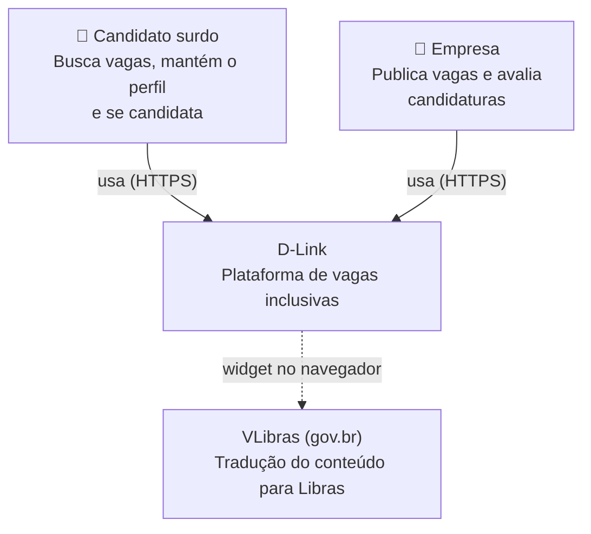
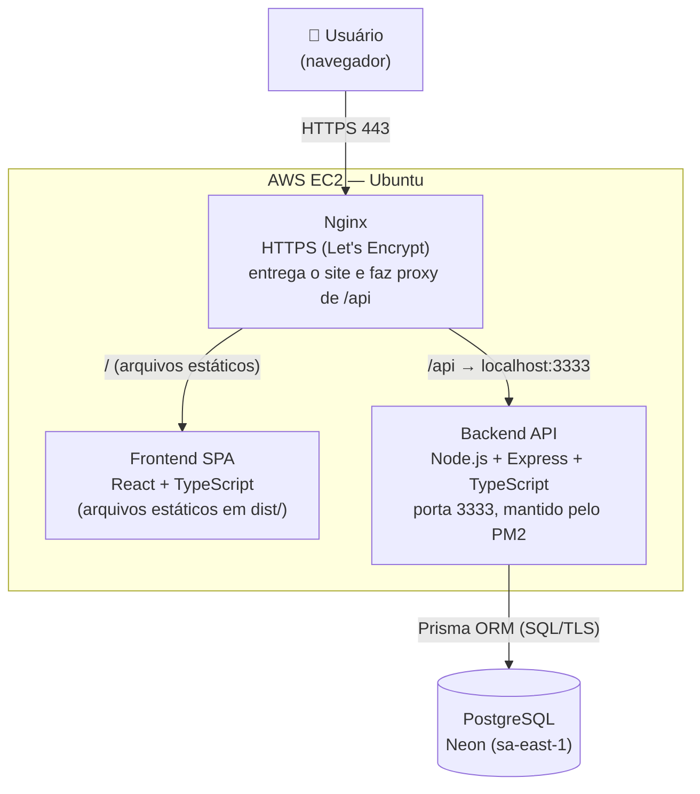
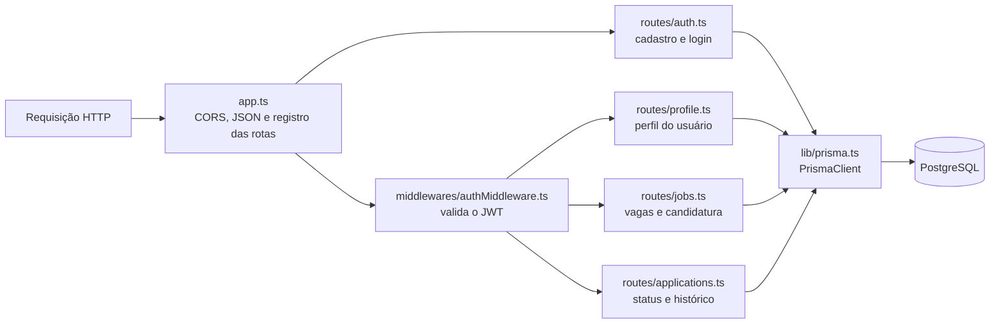

# Arquitetura

O D-Link é uma aplicação **cliente-servidor**: uma SPA em React conversa com uma API REST em Node.js/Express, que guarda os dados num PostgreSQL. Os diagramas seguem o modelo **C4**. As figuras originais estão no RFC do projeto (PAC VII).

## Nível 1 — Contexto

## Nível 2 — Containers

- O navegador só fala com o **Nginx** (portas 80 e 443). A porta 3333 da API **não fica aberta** para a internet: o Nginx repassa as chamadas `/api` por dentro da máquina.
- A comunicação é **JSON sobre HTTPS** no estilo REST.
- O frontend chama sempre `/api` (endereço relativo). Em produção quem repassa é o Nginx; no desenvolvimento é o proxy do Vite (`vite.config.ts`).

## Nível 3 — Componentes da API

| Componente | Responsabilidade |
|---|---|
| `Server/index.ts` | Carrega o `.env` e sobe o servidor (`app.listen`) |
| `Server/app.ts` | Monta o Express: middlewares e rotas. Fica separado do `listen` para os testes usarem a API sem subir o servidor |
| `Server/middlewares/authMiddleware.ts` | Lê o `Authorization: Bearer <token>`, valida o JWT e coloca `id` e `role` do usuário em `req.user` |
| `Server/routes/auth.ts` | `POST /register` (valida, criptografa a senha com bcrypt) e `POST /login` (gera o JWT válido por 1 dia) |
| `Server/routes/profile.ts` | `GET/PUT /me` — perfil do usuário logado; nunca devolve o hash da senha |
| `Server/routes/jobs.ts` | Listar, criar e encerrar vagas, candidatar-se, listar candidatos (só da própria empresa) |
| `Server/routes/applications.ts` | Histórico do candidato e aprovação/rejeição (só a empresa dona da vaga) |
| `Server/lib/prisma.ts` | Instância única do Prisma Client |

### Endpoints

| Método | Rota | Quem pode |
|---|---|---|
| GET | `/api/health` | público |
| POST | `/api/auth/register` | público |
| POST | `/api/auth/login` | público |
| GET / PUT | `/api/profile/me` | logado |
| GET | `/api/jobs` | logado |
| POST | `/api/jobs` | empresa |
| POST | `/api/jobs/:id/apply` | candidato |
| GET | `/api/jobs/company/me` | empresa |
| GET | `/api/jobs/:id/candidates` | empresa dona da vaga |
| PATCH | `/api/jobs/:id/close` | empresa dona da vaga |
| PUT | `/api/applications/:id/status` | empresa dona da vaga |
| GET | `/api/applications/me` | candidato |

## Frontend

| Arquivo | Responsabilidade |
|---|---|
| `src/App.tsx` | Decide a tela (login, cadastro, painel do candidato, painel da empresa) e guarda o usuário logado |
| `src/services/api.ts` | Axios com `baseURL: "/api"`, coloca o token em toda requisição e trata a sessão expirada (401) num lugar só |
| `src/componentes/Login.tsx`, `CriarConta.tsx` | Autenticação |
| `src/componentes/Dashboard.tsx` | Painel do candidato: vagas com busca e filtros, candidaturas e perfil |
| `src/componentes/Perfil.tsx` | Perfil profissional do candidato |
| `src/componentes/PainelEmpresa.tsx`, `PerfilEmpresa.tsx` | Painel da empresa |
| `src/componentes/SearchBar.tsx` | Barra de busca reutilizável |

## Caminho de uma requisição (exemplo: candidatar-se)

1. O candidato clica em "Candidatar-se" no `Dashboard.tsx`.
2. O `api.ts` envia `POST /api/jobs/:id/apply` com o token JWT no cabeçalho.
3. O Nginx recebe em HTTPS e repassa para `localhost:3333`.
4. O `authMiddleware` valida o token e identifica o usuário.
5. A rota em `jobs.ts` confere se é candidato, se já não existe candidatura e cria o registro via Prisma.
6. O PostgreSQL salva; a API responde `201` e a tela marca a vaga como "Candidatado".
