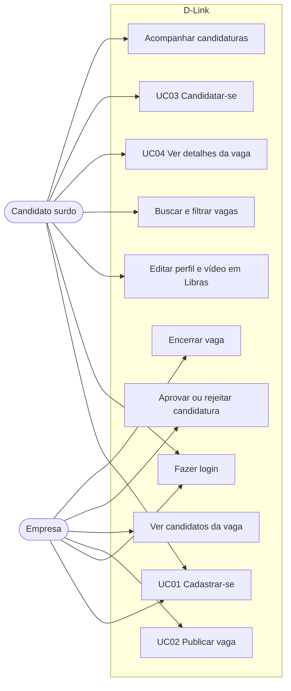

# Casos de Uso e User Stories

## Atores

- **Candidato surdo** — busca vagas, mantém o perfil profissional e se candidata.
- **Empresa** — publica vagas inclusivas e avalia as candidaturas.
- **Visitante** — usuário sem login; pode criar conta ou entrar.

## Casos de uso principais

### UC01 — Cadastrar-se como candidato surdo

- **Pré-condição:** o usuário não tem cadastro.
- **Fluxo principal:** acessa o cadastro → escolhe "Candidato" → preenche nome, e-mail e senha → informa grau de perda auditiva e preferência de comunicação → "Criar conta" → o sistema valida, cria a conta e já entra logado na tela inicial.
- **Exceções:** e-mail já cadastrado; senha com menos de 6 caracteres; senhas diferentes.
- **Pós-condição:** conta criada e usuário autenticado.

### UC02 — Publicar vaga

- **Ator:** empresa autenticada.
- **Fluxo principal:** no painel, "Criar vaga" → preenche título, descrição, requisitos, localidade e regime → "Publicar" → a vaga aparece no banco de vagas.
- **Exceção:** campos obrigatórios vazios → mensagem de erro, a vaga não é publicada.
- **Pós-condição:** vaga ativa e visível para os candidatos.

### UC03 — Candidatar-se a uma vaga

- **Ator:** candidato autenticado.
- **Fluxo principal:** encontra a vaga → "Candidatar-se" → o sistema pergunta se precisa de intérprete de Libras → registra a candidatura → a vaga aparece em "Minhas Candidaturas" com status "Em análise".
- **Fluxo alternativo:** o candidato indica que precisa de intérprete; a preferência fica salva junto com a candidatura e aparece para a empresa.
- **Exceção:** candidatura duplicada → o sistema avisa e não cria outra.

### UC04 — Visualizar detalhes da vaga

- **Ator:** candidato autenticado.
- **Fluxo principal:** no banco de vagas, vê título, empresa, área, descrição, localidade e regime de cada vaga e decide se candidatar.

## User stories

| # | Como... | Quero... | Para... | Critério de aceite |
|---|---|---|---|---|
| US01 | candidato surdo | criar conta informando minha preferência de comunicação | que as empresas saibam como falar comigo | Conta criada, já logado, preferência salva |
| US02 | candidato | buscar vagas por texto, localidade e área | achar rápido as vagas que servem para mim | A lista e o contador mudam ao filtrar; "Limpar filtros" volta tudo |
| US03 | candidato | dizer se preciso de intérprete ao me candidatar | ter acessibilidade na entrevista | O pedido de intérprete aparece para a empresa |
| US04 | candidato | acompanhar o status das minhas candidaturas | saber se fui aprovado | Status "Em análise", "Aprovado" ou "Rejeitado" |
| US05 | candidato | manter um perfil com experiência, formação, habilidades e vídeo em Libras | me apresentar na minha língua | Dados continuam lá depois de recarregar a página |
| US06 | empresa | publicar vagas inclusivas | atrair candidatos surdos | Vaga aparece para os candidatos |
| US07 | empresa | ver os candidatos de cada vaga com a preferência de comunicação | me preparar para o contato | Só aparecem candidatos das vagas da própria empresa |
| US08 | empresa | aprovar ou rejeitar candidaturas | dar retorno ao candidato | O candidato vê o novo status |
| US09 | empresa | encerrar uma vaga preenchida | parar de receber candidaturas sem perder o histórico | A vaga sai do banco de vagas, as candidaturas continuam |

## Fluxos de negócio completos

1. **Cadastro e acesso:** criar conta → entrar automaticamente → sair → login de novo.
2. **Recrutamento:** empresa publica vaga → candidato encontra e se candidata (com ou sem intérprete) → empresa vê o candidato e aprova ou rejeita → candidato vê o status.
3. **Perfil profissional:** candidato preenche e salva o perfil (experiência, formação, habilidades, vídeo em Libras); a empresa mantém os dados dela (CNPJ, setor, descrição).
4. **Ciclo de vida da vaga:** empresa publica → acompanha o número de candidaturas → encerra a vaga.
