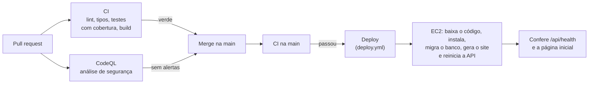

# Deploy

A aplicação roda numa **AWS EC2 (Ubuntu)** e é publicada automaticamente pelo **GitHub Actions** a cada merge na `main`. Ninguém faz deploy à mão.

- **Produção:** https://deaflink.duckdns.org
- **Banco:** PostgreSQL na Neon (região `sa-east-1`, São Paulo)

## Ambientes

| Ambiente | Onde roda | Banco | Como atualiza |
|---|---|---|---|
| Desenvolvimento | Computador do desenvolvedor (`npm run dev` + `npm run dev:server`) | Branch de desenvolvimento na Neon | Ao salvar o arquivo |
| Produção | AWS EC2 + Nginx + PM2 | Branch `production` na Neon | Automático, a cada merge na `main` |

## Pipeline de CI/CD



### Workflows (`.github/workflows/`)

| Arquivo | Quando roda | O que faz |
|---|---|---|
| `ci.yml` | Todo push e pull request | ESLint → checagem de tipos → testes com cobertura (falha abaixo de 75% no backend ou 25% no frontend) → build → SonarCloud (quando o segredo `SONAR_TOKEN` existe) |
| `codeql.yml` | Push e PR na `main` e toda segunda-feira | Análise de segurança do código; alertas aparecem em *Security → Code scanning* e bloqueiam o PR |
| `deploy.yml` | Depois que o CI passa na `main`, ou na mão em *Actions → Deploy → Run workflow* | Publica a versão testada na EC2 |

Se o CI falhar (lint, tipo, teste ou cobertura), o deploy **não acontece** e a versão no ar continua a anterior.

### O que o deploy faz na EC2 (`deploy/deploy.sh`)

1. Baixa o código e coloca a pasta exatamente no commit que o CI testou (`git reset --hard <sha>`). Guarda uma cópia do `.env` antes, por segurança.
2. Reinstala as dependências **só se o `package-lock.json` mudou** (economiza memória na EC2).
3. `npx prisma generate` e `npx prisma migrate deploy` (aplica só as migrations novas).
4. `npm run build` gera o site em `dist/`, que o Nginx entrega.
5. Reinicia a API no PM2 (`dlink-api`) e roda `pm2 save`.
6. Confere se `http://localhost:3333/api/health` responde; se não, mostra o log da API e falha.

### Segredos do GitHub

Em *Settings → Secrets and variables → Actions*:

| Segredo | Conteúdo |
|---|---|
| `EC2_HOST` | `deaflink.duckdns.org` |
| `EC2_SSH_KEY` | Chave privada de acesso à EC2 |
| `SONAR_TOKEN` | Token do SonarCloud |

Senhas do banco e o `JWT_SECRET` **não** ficam no GitHub: ficam só no `.env` da EC2 (`/home/ubuntu/Dlink/.env`, permissão `600`).

## Infraestrutura da EC2 (configuração feita uma vez)

- **Ubuntu** com Node.js 20, Nginx, PM2 e Certbot.
- **Nginx** (`/etc/nginx/sites-enabled/`):
  - porta 80 redireciona para HTTPS;
  - porta 443 com certificado Let's Encrypt;
  - `/` entrega `/home/ubuntu/Dlink/dist` (com `try_files ... /index.html` para a SPA);
  - `/api` faz proxy para `http://localhost:3333`.
- **PM2** mantém a API rodando e religa sozinho depois de reiniciar a máquina (`pm2 startup` + `pm2 save`).
- **Swap de 2 GB** (`/swapfile`), porque a máquina é pequena e a instalação de dependências precisava de mais memória.
- **Security Group:** entram só as portas 80 e 443 (público) e 22 (acesso administrativo). A porta 3333 da API fica fechada; só o Nginx fala com ela.
- **Domínio:** `deaflink.duckdns.org` aponta para o IP da EC2.

## Como voltar para a versão anterior (rollback)

1. No GitHub, abra o pull request que causou o problema e clique em **Revert**. O GitHub cria um PR desfazendo as mudanças.
2. Faça o merge desse PR. O CI roda e o deploy publica a versão anterior automaticamente.

Para republicar a `main` atual sem mudar código (por exemplo, depois de religar a EC2): *Actions → Deploy → Run workflow*.

## Logs e diagnóstico na EC2

```bash
pm2 status                              # a API está rodando?
pm2 logs dlink-api --lines 50           # últimos logs da API
sudo tail -n 50 /var/log/nginx/error.log
curl http://localhost:3333/api/health
free -h                                  # memória e swap
```
