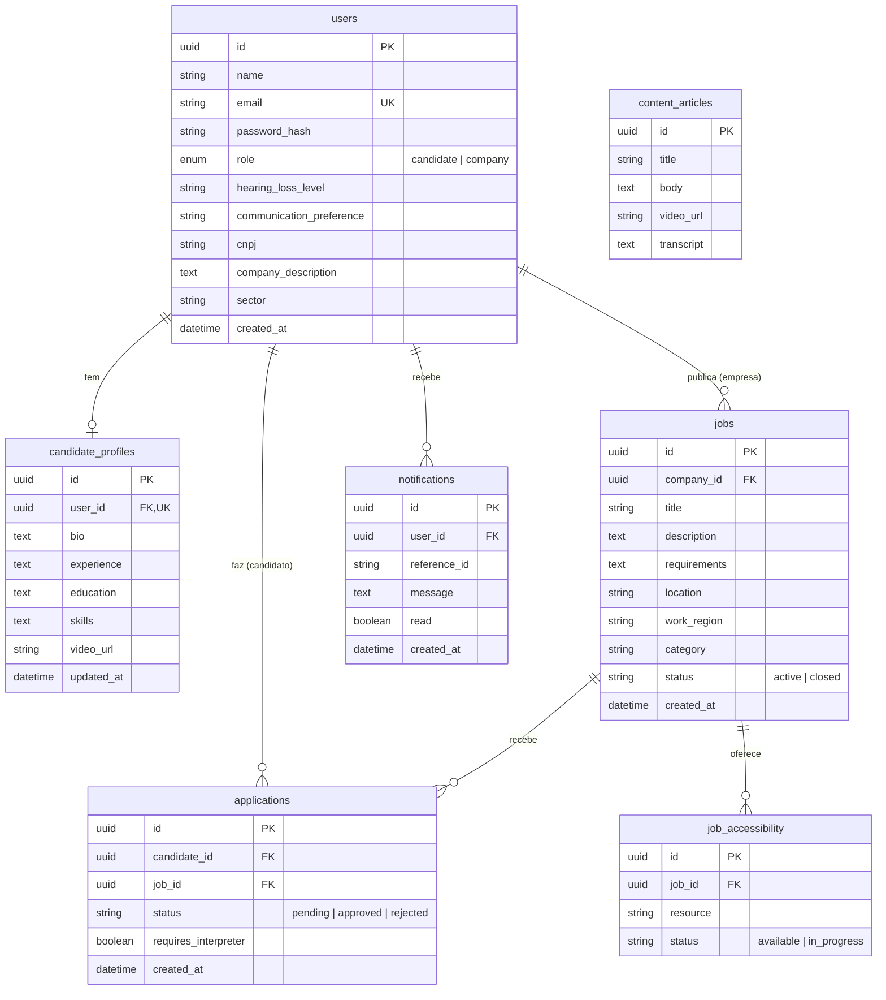

# Modelo de Dados

O modelo está definido em `prisma/schema.prisma`, e as tabelas são criadas pelas migrations em `prisma/migrations/`.

## Decisões do modelo

- **Uma tabela `users` para candidatos e empresas**, separados pelo campo `role`. Os campos de candidato (perda auditiva, comunicação) e de empresa (CNPJ, setor, descrição) são opcionais. Simplifica login e autenticação, que são iguais para os dois perfis.
- **`applications` tem `@@unique([candidateId, jobId])`**: o próprio banco impede candidatura duplicada (RN04), além da checagem na API.
- **Vagas não são apagadas, só encerradas** (`status = closed`), para manter o histórico das candidaturas (RN08).
- **`onDelete: Cascade`**: se um usuário for removido, os dados ligados a ele também saem (apoio à LGPD).
- `job_accessibility`, `notifications` e `content_articles` já estão no banco para RF12, RF18 e RF22/RF23 (ver [[Requisitos]]).
